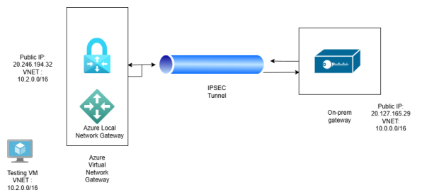
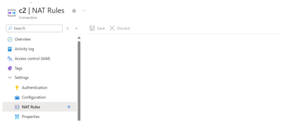
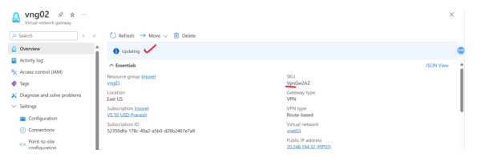
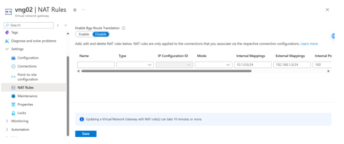
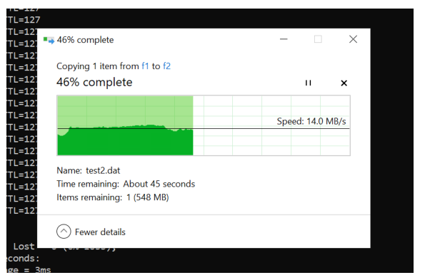
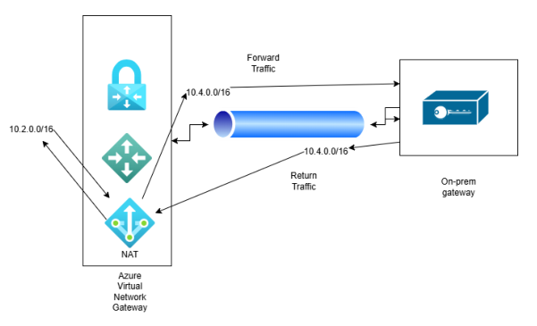

# 🚀 Azure VPN Gateway SKU Upgrade & Network Address Translation (NAT) Guide

> **Document Type:** Proof of Concept (POC) & Technical Blueprint  
> **Platform:** Microsoft Azure Infrastructure  
> **Topics Covered:** Virtual Network Gateway, SKU Resizing, Network Address Translation (1:1 Static SNAT), IPsec S2S VPN  

---

## 📌 Executive Summary

This document demonstrates the end-to-end technical procedure for **resizing an Azure Virtual Network Gateway SKU** and subsequently configuring **Static Network Address Translation (NAT) rules** over a Site-to-Site (S2S) IPsec VPN tunnel.

In hybrid network topologies, overlapping IP address spaces or administrative constraints often prevent direct routing between cloud networks and on-premises environments. This guide illustrates a real-world scenario where an existing Azure VNET (`10.2.0.0/16`) conflicts with external routing requirements, requiring an in-flight SKU upgrade (from `VpnGw1AZ` to `VpnGw2AZ`) to unlock Azure's native NAT functionality and seamlessly translate outbound/inbound traffic to an alternative range (`10.4.0.0/16`).

---

## 🎯 Objectives & Key Takeaways

1. **Gateway Upgrade & Resilience Monitoring:**
   - Resize an active Azure Virtual Network Gateway (`VpnGw1AZ` $\rightarrow$ `VpnGw2AZ`).
   - Evaluate network loss, downtime, and packet behavior during the gateway reconfiguration phase.

2. **Overlapping IP Space Resolution via NAT:**
   - Enable NAT features post-upgrade to prevent CIDR overlapping and routing collisions.
   - Configure **Egress SNAT** (`10.2.0.0/16` $\rightarrow$ `10.4.0.0/16`) and **Ingress SNAT** (`10.4.0.0/16` $\rightarrow$ `10.2.0.0/16`).

3. **Packet Analysis & Verification:**
   - Validate 1:1 NAT mapping using ICMP ping tests and TCP port probing.
   - Perform Wireshark packet inspection on the target remote endpoint to verify source translation.

---

## 🏗️ Reference Architecture Overview

```
+-----------------------------------------------------------------------------------+
|                                  AZURE VNET                                       |
|                                                                                   |
|   +-------------------+                     +---------------------------------+   |
|   |   Test Workload   |  10.2.0.6           |  Azure Virtual Network Gateway  |   |
|   |   (Azure VM)      | ------------------> |  Public IP: 20.246.194.32        |   |
|   +-------------------+                     |  Primary Range: 10.2.0.0/16     |   |
+-------------------------------------------- |  NAT Range:     10.4.0.0/16     | --+
                                              +---------------------------------+
                                                               |
                                                       IPsec S2S Tunnel
                                                       (NAT Translation)
                                                               |
                                                               v
+-----------------------------------------------------------------------------------+
|                               ON-PREMISES NETWORK                                 |
|                                                                                   |
|   +---------------------------------+       +---------------------------------+   |
|   |  On-Prem Gateway / Router       |       |  On-Prem Target Workload        |   |
|   |  Public IP: 20.127.165.29       | ----> |  Address: 10.0.0.4              |   |
|   |  Subnet:    10.0.0.0/16         |       |  (Sees source as 10.4.0.6)      |   |
|   +---------------------------------+       +---------------------------------+   |
+-----------------------------------------------------------------------------------+
```

---

## 📋 Topology & Configuration Details

| Component | Identifier / IP Address | Subnet / Address Space | Role / Description |
| :--- | :--- | :--- | :--- |
| **Azure VNET** | — | `10.2.0.0/16` | Main workload VNET hosting test resources |
| **Azure Secondary Subnet** | — | `10.4.0.0/16` | Range designated for NAT translation |
| **Azure VPN Gateway** | `20.246.194.32` | `VpnGw1AZ` $\rightarrow$ `VpnGw2AZ` | VNG performing IPsec encryption and NAT |
| **Simulated On-Prem Gateway** | `20.127.165.29` | `10.0.0.0/16` | Windows RRAS Server handling S2S connection |
| **Azure Testing VM** | `10.2.0.6` | `10.2.0.0/24` | Workload initiating outbound traffic |
| **On-Prem Target VM** | `10.0.0.4` | `10.0.0.0/24` | Remote host receiving translated traffic |

---

# POC VPN Gateway SKU Upgrade & NAT



## Setup:
Configure an Azure virtual network gateway with local network gateway pointing to on-premise router or gateway, we'll simulate this by using a VM.

* **Azure VPN Gateway:**
  * **Public IP:** `20.246.194.32`
  * **VNET:** `10.2.0.0/16`

* **On-Prem Gateway (Simulated by Azure VM):**
  * **Public IP:** `20.127.165.29`
  * **VNET:** `10.0.0.0/16`

* **Local Network Gateway:**
  * **IP:** `20.127.165.29`
  * **Address Space(s):** `10.0.0.0/16`
  * **Connection:** IKEv2 with pre-shared key

We'll also need a testing VM in the same VNET as the Azure virtual network gateway to perform the VPN tunnel test.

The on-prem simulation is done on an Azure VM by using the Routing and Remote Access module (Windows Server component).

The details on configuring it are at the public article: *How to Configure Site-to-Site VPN Connection on Azure - ABC of Cloud Computing*.

---

In the below example, `10.2.x.x` and `10.0.x.x` are peered.

```cmd
C:\Windows\system32\cmd.exe - ping 10.2.0.6
Reply from 10.2.0.6: bytes=32 time=3ms TTL=127
Reply from 10.2.0.6: bytes=32 time=4ms TTL=127
Reply from 10.2.0.6: bytes=32 time=4ms TTL=127
Reply from 10.2.0.6: bytes=32 time=4ms TTL=127
Reply from 10.2.0.6: bytes=32 time=3ms TTL=127
Reply from 10.2.0.6: bytes=32 time=3ms TTL=127
Reply from 10.2.0.6: bytes=32 time=3ms TTL=127
Reply from 10.2.0.6: bytes=32 time=4ms TTL=127
Reply from 10.2.0.6: bytes=32 time=3ms TTL=127
Reply from 10.2.0.6: bytes=32 time=4ms TTL=127
```

```cmd
C:\Windows\system32\cmd.exe - ping 10.0.0.4
Reply from 10.0.0.4: bytes=32 time=5ms TTL=127
Reply from 10.0.0.4: bytes=32 time=4ms TTL=127
Reply from 10.0.0.4: bytes=32 time=4ms TTL=127
Reply from 10.0.0.4: bytes=32 time=4ms TTL=127
Reply from 10.0.0.4: bytes=32 time=4ms TTL=127
Reply from 10.0.0.4: bytes=32 time=12ms TTL=127
Reply from 10.0.0.4: bytes=32 time=4ms TTL=127
Reply from 10.0.0.4: bytes=32 time=3ms TTL=127
```

In Azure virtual network gateway, we see the connection status.

| Name | Status | Connection type | Peer |
| :--- | :--- | :--- | :--- |
| c2 | Connected | Site-to-site (IPsec) | vng02 |

Some amount of traffic has moved through the tunnel, this can be tested by sending a file (1 GB) over the tunnel, and we can see the same below.

| Resource group | Status | Data in | Data out |
| :--- | :--- | :--- | :--- |
| vng01 | Connected | 1.04 GiB | 4.96 MiB |

On the simulation of the on-prem gateway, we set up Routing and Remote Access as shown below:

* **Routing and Remote Access**
  * **Server Status**
  * **vm01 (local)**
    * **Network Interfaces**
      * `stos2`: Type: Demand-dial, Status: Enabled, Connection State: Connected
      * `Loopback`: Type: Loopback, Status: Enabled, Connection State: Connected
      * `Internal`: Type: Internal, Status: Enabled, Connection State: Connected
      * `Ethernet`: Type: Dedicated, Status: Enabled, Connection State: Connected (Microsoft Hyper-V Network Adapter)
    * **Ports**
    * **Remote Access Logging**
    * **IPv4**
      * General
      * Static Routes
    * **IPv6**
      * General
      * Static Routes

---



In the current SKU of virtual network gateway (`VpnGw1AZ`), we can't see the option of configuring NAT rules.



Let's start the resize operation from `VpnGw1AZ` to `VpnGw2AZ`. The gateway status goes to updating mode, and the new SKU is visible.

We'll see network drops in between when the resize operation is going on.

---

```cmd
Administrator: C:\Windows\system32\cmd.exe - ping -t 10.0.0.4
Reply from 10.0.0.4: bytes=32 time=3ms TTL=127
Request timed out.
Request timed out.
Request timed out.
Request timed out.
Request timed out.
Request timed out.
Request timed out.
Request timed out.
Request timed out.
Request timed out.
Request timed out.
Request timed out.
Request timed out.
Request timed out.
Reply from 10.0.0.4: bytes=32 time=4ms TTL=127
Reply from 10.0.0.4: bytes=32 time=2ms TTL=127
Reply from 10.0.0.4: bytes=32 time=2ms TTL=127
Reply from 10.0.0.4: bytes=32 time=2ms TTL=127
Reply from 10.0.0.4: bytes=32 time=2ms TTL=127
Reply from 10.0.0.4: bytes=32 time=2ms TTL=127
Reply from 10.0.0.4: bytes=32 time=2ms TTL=127
Reply from 10.0.0.4: bytes=32 time=2ms TTL=127
Reply from 10.0.0.4: bytes=32 time=2ms TTL=127
Reply from 10.0.0.4: bytes=32 time=7ms TTL=127
Reply from 10.0.0.4: bytes=32 time=2ms TTL=127
Reply from 10.0.0.4: bytes=32 time=2ms TTL=127
Reply from 10.0.0.4: bytes=32 time=2ms TTL=127
Request timed out.
Request timed out.
Request timed out.
Request timed out.
Request timed out.
Request timed out.
Request timed out.
Request timed out.
```

---

In case the on-prem gateway shows a disconnected state, manually connect it again. This should resume connectivity in the tunnel.

* **Routing and Remote Access**
  * **LAN and Demand Dial Interfaces:**
    * `stos2`: Type: Demand-dial, Status: Enabled, Connection State: **Disconnected**

---





Once the resize operation completes (which took around an hour), the NAT rules option becomes visible under `vng02 | NAT Rules`.

Test the IPsec tunnel by moving a 1 GB file again, and it succeeds (`test2.dat`, Speed: $14.0\text{ MB/s}$, $46\%$ complete).

---

Tunnel status shows connected.

| Name | Status | Connection type | Peer |
| :--- | :--- | :--- | :--- |
| c2 | Connected | Site-to-site (IPsec) | vng02 |

Data inflow to tunnel verifies tunnel is operational (`Data in: 2.07 GiB`, `Data out: 9.14 MiB`).

## NAT Setup for Virtual Network Gateway

### Requirement:
As set up in the previous procedure, there is an IPsec tunnel established between these two gateway devices:

* **Azure VPN Gateway:**
  * **Public IP:** `20.246.194.32`
  * **VNET:** `10.2.0.0/16`

* **On-Prem Gateway (Simulated by Azure VM):**
  * **Public IP:** `20.127.165.29`
  * **VNET:** `10.0.0.0/16`

However, on the on-prem side of the setup, the network administrator requires no traffic to originate from the source `10.2.0.0/16`, because they want to use this range to set up a tunnel with another office which is networked with the `10.2.0.0/16` range. They cannot set up a tunnel with the other office as this network collides with the Azure VNET as well.

To address this, we can NAT the range `10.2.0.0/16` to `10.4.0.0/16`, after which the on-prem network administrator will only see traffic originating from `10.4.0.0/16` and will be free to take `10.2.0.0/16` out of the encryption domain and reuse it to add the other office.

---

We need to first add an additional address space `10.4.0.0/16` on the VNET attached to Azure VPN Gateway.

| Address space | Address range | Address count |
| :--- | :--- | :--- |
| `10.2.0.0/16` | 10.2.0.0 - 10.2.255.255 | 65,536 |
| `10.4.0.0/16` | 10.4.0.0 - 10.4.255.255 | 65,536 |

This is required so that traffic originating from `10.2.0.0/16` translates to `10.4.0.0/16` before going out of the Azure VPN Gateway, presenting itself as `10.4.0.0/16` to the on-premises gateway.

Let's add two NAT rules as follows:

| Name | Type | IP Configuration ID | Mode | Internal Mappings | External Mappings |
| :--- | :--- | :--- | :--- | :--- | :--- |
| `nat02` | Static | - | EgressSnat | `10.2.0.0/16` | `10.4.0.0/16` |
| `nat01` | Static | - | IngressSnat | `10.4.0.0/16` | `10.2.0.0/16` |

* **EgressSnat:** Traffic originating from Azure at `10.2.0.0/16` will NAT to `10.4.0.0/16` before leaving the Azure VPN gateway.
* **IngressSnat:** Traffic returning back from the on-premises gateway with `10.4.0.0/16` as destination will NAT back to `10.2.0.0/16` before exiting the Azure VPN gateway.

---

Also, on the on-premises gateway, we should add a static route for `10.4.0.0/16`:

```text
Routing and Remote Access -> Static Routes:
Destination: 10.4.0.0 | Network mask: 255.255.0.0 | Gateway: None | Interface: stos2 | Metric: 256
Destination: 10.2.0.0 | Network mask: 255.255.0.0 | Gateway: None | Interface: stos2 | Metric: 256
```

Associate the rules with the VPN connection as follows, and save it:
* **Ingress NAT Rules:** `nat01`
* **Egress NAT Rules:** `nat02`

Now, if we send traffic from the Azure VPN gateway to the on-premises gateway originating from `10.2.0.0/16`, it will NAT to `10.4.0.0/16`.

For example, if we ping `10.0.0.4` (on-premises gateway) from a machine in the Azure VNET (`10.2.0.6`), traffic will NAT to `10.4.0.6` before reaching the on-premises gateway.

```cmd
C:\Users\lcadmin>ipconfig

Windows IP Configuration

Ethernet adapter Ethernet:
   Connection-specific DNS Suffix  . : roxt3xp2wurevnevy44q01
   Link-local IPv6 Address . . . . . : fe80::1f:b197:52ee:1e6
   IPv4 Address. . . . . . . . . . . : 10.2.0.6
   Subnet Mask . . . . . . . . . . . : 255.255.255.0
   Default Gateway . . . . . . . . . : 10.2.0.1
```

---

```cmd
C:\Users\lcadmin>ping -t 10.0.0.4

Pinging 10.0.0.4 with 32 bytes of data:
Reply from 10.0.0.4: bytes=32 time=4ms TTL=127
Reply from 10.0.0.4: bytes=32 time=3ms TTL=127
Reply from 10.0.0.4: bytes=32 time=5ms TTL=127
Reply from 10.0.0.4: bytes=32 time=4ms TTL=127
Reply from 10.0.0.4: bytes=32 time=4ms TTL=127
Reply from 10.0.0.4: bytes=32 time=4ms TTL=127
Reply from 10.0.0.4: bytes=32 time=3ms TTL=127
Reply from 10.0.0.4: bytes=32 time=4ms TTL=127
```

---

On the On-premises gateway, we can see traffic originating from `10.4.0.6` using Wireshark:

| No. | Time | Source | Destination | Protocol | Length | Info |
| :--- | :--- | :--- | :--- | :--- | :--- | :--- |
| 49 | 837.436955 | 10.0.0.4 | 10.4.0.6 | ICMP | 74 | Echo (ping) reply id=0x0001, seq=... |
| 50 | 838.454190 | 10.4.0.6 | 10.0.0.4 | ICMP | 74 | Echo (ping) request id=0x0001, seq=... |
| 51 | 838.454315 | 10.0.0.4 | 10.4.0.6 | ICMP | 74 | Echo (ping) reply id=0x0001, seq=... |
| 52 | 839.471294 | 10.4.0.6 | 10.0.0.4 | ICMP | 74 | Echo (ping) request id=0x0001, seq=... |
| 53 | 839.471414 | 10.0.0.4 | 10.4.0.6 | ICMP | 74 | Echo (ping) reply id=0x0001, seq=... |
| 54 | 840.477780 | 10.4.0.6 | 10.0.0.4 | ICMP | 74 | Echo (ping) request id=0x0001, seq=... |
| 55 | 840.477889 | 10.0.0.4 | 10.4.0.6 | ICMP | 74 | Echo (ping) reply id=0x0001, seq=... |

Notice how the return traffic also goes back to `10.4.0.6`, but it will be NATTed to `10.2.0.6` before reaching the destination.

| No. | Time | Source | Destination | Protocol | Length | Info |
| :--- | :--- | :--- | :--- | :--- | :--- | :--- |
| 19228 | 2067.487503 | 10.2.0.6 | 10.0.0.4 | ICMP | 74 | Echo (ping) request |
| 19229 | 2067.491054 | 10.0.0.4 | 10.2.0.6 | ICMP | 74 | Echo (ping) reply |
| 19272 | 2068.494964 | 10.2.0.6 | 10.0.0.4 | ICMP | 74 | Echo (ping) request |
| 19273 | 2068.499028 | 10.0.0.4 | 10.2.0.6 | ICMP | 74 | Echo (ping) reply |

---

If we do a TCP test:

```powershell
PS C:\Users\lcadmin> Test-NetConnection -ComputerName 10.0.0.4 -port 139

ComputerName           : 10.0.0.4
RemoteAddress          : 10.0.0.4
Remote Port            : 139
InterfaceAlias         : Ethernet
SourceAddress          : 10.2.0.6
TcpTestSucceeded       : True
```

We can see the same NAT happening in Wireshark (`tcp.port == 139`):

| No. | Time | Source | Destination | Protocol | Length | Info |
| :--- | :--- | :--- | :--- | :--- | :--- | :--- |
| 1 | 0.000000 | 10.4.0.6 | 10.0.0.4 | TCP | 66 | 49568 -> 139 [SYN, ECE, CWR] |
| 2 | 0.000117 | 10.0.0.4 | 10.4.0.6 | TCP | 66 | 139 -> 49568 [SYN, ACK, ECE] |
| 3 | 0.003614 | 10.4.0.6 | 10.0.0.4 | TCP | 54 | 49568 -> 139 [ACK] |
| 4 | 0.004125 | 10.4.0.6 | 10.0.0.4 | TCP | 54 | 49568 -> 139 [FIN, ACK] |
| 5 | 0.004166 | 10.0.0.4 | 10.4.0.6 | TCP | 54 | 139 -> 49568 [FIN, ACK] |
| 6 | 0.007064 | 10.4.0.6 | 10.0.0.4 | TCP | 54 | 49568 -> 139 [ACK] |

Return traffic is NATTed back to `10.2.0.6`:

| No. | Time | Source | Destination | Protocol | Length | Info |
| :--- | :--- | :--- | :--- | :--- | :--- | :--- |
| 9040 | 904.254044 | 10.2.0.6 | 10.0.0.4 | TCP | 54 | 49548 -> 139 [ACK] |
| 9041 | 904.254388 | 10.2.0.6 | 10.0.0.4 | TCP | 54 | 49548 -> 139 [FIN, ACK] |
| 9042 | 904.257725 | 10.0.0.4 | 10.2.0.6 | TCP | 54 | 139 -> 49548 [FIN, ACK] |
| 9043 | 904.257748 | 10.2.0.6 | 10.0.0.4 | TCP | 54 | 49548 -> 139 [ACK] |

---



### Illustration Summary:

* **Forward Traffic:** Traffic originating from `10.2.0.0/16` inside the Azure VNET passes through the Azure Virtual Network Gateway NAT, translates into `10.4.0.0/16`, and traverses the IPsec tunnel to the On-prem Gateway.
* **Return Traffic:** Return traffic directed to `10.4.0.0/16` traverses the IPsec tunnel, reaches the Azure Virtual Network Gateway NAT, and translates back to `10.2.0.0/16` before reaching the source VM.

## Author - Pranesh Sathyanarayan
### Published First : 27 Oct 2026
#### AI agent disclosure - no AI used to generate content, gemini AI was used only to perform markdown formatting and beautification.

#### "This work is dedicated to the public domain under CC0 1.0 Universal. You are free to copy, modify, distribute, and perform the work, even for commercial purposes, all without asking permission."
